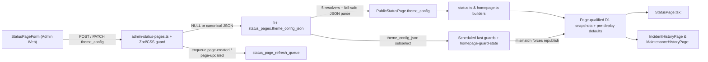

# Status-page theme customization (custom CSS and footer)

**Design risk**: High — introduces admin-authored inline CSS onto public HTML/DOM routes and extends persisted status-page snapshot, fast-guard, and cross-page cache contracts across Worker and Web.
**Diagram decision**: required
**Diagram reason**: `theme_config` crosses D1 `status_pages.theme_config_json`, five status-page resolvers, status and homepage payload/snapshot builders, stored-snapshot readers, scheduled fast-guard comparators, and route-scoped React `<style>` and `<footer>` consumers; missing any link silently breaks invalidation or leaks styling across pages.
**Output language**: English.

## Outcome and boundary

Deliver controlled per-status-page style customization backed by the existing `status_pages.theme_config_json` column: validated inline `custom_css` (`<= 16384` characters) applied to each status page's main view and associated incident/maintenance history subpages without leaking into `/admin` or other status pages, plus per-page `footer_hidden` and single-line plain-text `footer_text` on the status-page main view.

Keep the complete delivery in one vertical Slice, `status-page-theme-customization`: there is no database migration (`status_pages.theme_config_json` already exists), Worker and Web share one end-to-end branding/snapshot/cache-isolation contract, splitting Worker from Web would leave `BR-SCN-1` and `BR-SCN-2` unobservable on the first slice, and the entire change shares one rollback boundary.

## Discovery evidence

- `CONTEXT.md`, `docs/solutions/adding-per-page-public-branding-field.md`, `docs/solutions/multi-status-page-cache-isolation.md`: authoritative branding pipeline checklist and page-qualified cache isolation rules. `.imm/memory/current_iteration.json` is absent; `CONTEXT.md` terminology placeholders are unused here.
- `apps/worker/migrations/0014_status_pages.sql`, `packages/db/src/schema.ts`: `status_pages.theme_config_json` (`TEXT`, nullable) already exists in D1 and Drizzle schema; no new migration file is needed.
- `apps/worker/src/public/status-page.ts`: `PublicStatusPage` and five `SELECT` queries (`resolvePublicStatusPage`, `resolveAccessibleStatusPage`, `resolveAccessibleStatusPageById`, `resolvePublicStatusPageById`, `resolvePublicStatusPageByHostname`) own status-page resolution.
- `apps/worker/src/schemas/status-pages.ts`, `apps/worker/src/routes/admin-status-pages.ts`: Admin create/patch Zod schemas, `StatusPageRow`, `GET`/`POST`/`PATCH` SQL column lists, `toApi`, and `enqueueStatusPageRefreshes`.
- `apps/worker/src/schemas/public-status.ts`, `apps/worker/src/schemas/public-status-stored.ts`, `apps/worker/src/snapshots/public-status-read.ts`: runtime status schema, fast custom stored-snapshot validator, and snapshot read normalizer.
- `apps/worker/src/schemas/public-homepage.ts`, `apps/worker/src/schemas/public-homepage-stored.ts`, `apps/worker/src/snapshots/public-homepage-read.ts`: runtime homepage/artifact schemas, fast custom stored-snapshot validator, and snapshot read normalizer. Notice `parseEnvelopeFragment` in `apps/worker/src/snapshots/public-monitor-fragments.ts` requires output-typed Zod defaults (`z.ZodType<T, z.ZodTypeDef, unknown>`).
- `apps/worker/src/public/status.ts`, `apps/worker/src/public/status-refresh.ts`, `apps/worker/src/public/homepage.ts`, `apps/worker/src/public/homepage-guard-state.ts`, `apps/worker/src/internal/homepage-refresh-core.ts`, `apps/worker/src/routes/public.ts`: payload builders, `status_page` response metadata, cached homepage guard state, and scheduled fast-guard SQL subselects + equality comparisons (`hasMatching*PublicSettings`).
- `apps/web/src/api/types.ts`, `apps/web/src/main.tsx`, `apps/web/src/app/router.tsx`, `apps/web/src/app/useApplyServerLocaleSetting.ts`, `apps/web/src/pages/StatusPage.tsx`, `apps/web/src/pages/IncidentHistoryPage.tsx`, `apps/web/src/pages/MaintenanceHistoryPage.tsx`, `apps/web/src/components/StatusPageForm.tsx`, `apps/web/src/i18n/messages.ts`: Web API contracts, `homepageFromStatus` local cache adapter, public main + history routes (both history pages already query `fetchStatus(slug)`), `StatusPage` footer markup, Admin form, and 5-locale labels (`en`, `zh-CN`, `zh-TW`, `ja`, `es`).
- `apps/worker/vitest.config.ts`, `apps/web/vitest.config.ts`, `apps/worker/test/admin-status-pages.test.ts`, `apps/worker/test/status-page-logo-url-schema.test.ts`, `apps/worker/test/public-fast-path-guards.test.ts`, `apps/web/src/app/adminNavigation.test.ts`: both `@uptimer/worker` and `@uptimer/web` run Vitest in `environment: 'node'` with no `jsdom` dependency.

## Decisions and provenance

Each decision has exactly one source.

| Decision | Source | Contract |
| --- | --- | --- |
| D1 | BR-REQ-1 | Persist per-page style configuration in `status_pages.theme_config_json` validated with Zod, and expose create/patch/read controls across Admin Status Page APIs, `StatusPageForm.tsx`, and all 5 locales (`en`, `zh-CN`, `zh-TW`, `ja`, `es`). |
| D2 | BR-DEC-1 | Bound scope strictly to controlled per-page style customization via `status_pages.theme_config_json`. |
| D3 | BR-DEC-3 | Store inline `custom_css` (`<= 16384` trimmed characters) and reject HTML/tag breakout (`<` / `</style`), `javascript:`, `expression(`, and `@import` cascading on Admin writes. |
| D4 | BR-DEC-4 | Apply resolved `custom_css` to Status Page main routes (`/`, `/status/:slug`, custom-domain `/`) and associated Incident/Maintenance History subroutes (`/history/incidents`, `/history/maintenance`, `/status/:slug/history/*`), while isolating `/admin` and other status pages. |
| D5 | BR-DEC-2 | Support only `footer_hidden` (boolean, default `false`) and optional single-line plain-text `footer_text` on the Status Page main view; omit external link arrays. |
| D6 | Delegated technical choice | Represent style settings across Admin and Public JSON contracts as one canonical object `theme_config: { custom_css: string \| null, footer_hidden: boolean, footer_text: string \| null }` defaulting to `{ custom_css: null, footer_hidden: false, footer_text: null }`; serialize all-default values as `NULL` in `status_pages.theme_config_json` and parse corrupt/legacy DB JSON safely to defaults. |
| D7 | Delegated technical choice | Enforce concrete input bounds and escape-aware CSS checks: `custom_css` max `16384` trimmed chars with `\t`/`\n`/`\r` allowed and other C0/DEL controls rejected, inspecting both raw text and CSS comment-stripped + hex-unescaped text to reject `<`, `@import`, `javascript:`, `vbscript:`, `data:text/html`, `expression(`, `-moz-binding`, and `behavior:`; `footer_text` max `200` trimmed single-line chars rejecting `\r`, `\n`, and C0/DEL controls. |
| D8 | Delegated technical choice | Mount `custom_css` through a single `<style id="uptimer-status-page-custom-css" data-status-page="...">` node in `document.head` using `styleEl.textContent` (never `innerHTML`), apply client-side defense-in-depth validation, clear immediately when the resolved page key lacks CSS or switches while loading, and remove on component unmount so `/admin` routes stay clean. |
| D9 | BR-OUT-1 | Exclude page and monitor card layout customization (`status_page_monitors` per-page group/sort UI, grid column toggles, section/card element toggles). |
| D10 | BR-OUT-2 | Exclude per-page light/dark color-mode default or lock configuration. |
| D11 | BR-OUT-3 | Exclude per-page preset palettes and custom brand accent Hex colors. |
| D12 | BR-OUT-4 | Exclude `logo_dark_url` and per-page `favicon_url`. |
| D13 | BR-OUT-5 | Exclude external CSS URLs, `@import` stylesheets, footer link arrays, HTML in footer text, and file upload / R2 storage. |

## Technical Design

**Design views**: service/component interfaces, data flow.

Omitted views cannot affect this design: *architecture layers* do not change because no package, dependency, or cross-layer import is introduced; *state transitions* do not change because monitor, incident, and refresh-queue state machines keep their exact states and triggers (`'page-created'` / `'page-updated'`); *temporal sequence* does not change because Admin writes, snapshot reads/refreshes, and React route effects follow the established `logo_url` and `useApplyServerLocaleSetting` lifecycles.

### Service and component interfaces

1. **Canonical data shape (`StatusPageThemeConfig`)**:
   - Output shape on `PublicStatusPage`, Admin `StatusPage`, `PublicStatusResponse`, `PublicHomepageResponse`, and `routes/public.ts` `status_page` metadata:
     ```ts
     export type StatusPageThemeConfig = {
       custom_css: string | null;
       footer_hidden: boolean;
       footer_text: string | null;
     };
     ```
   - Default constant `DEFAULT_STATUS_PAGE_THEME_CONFIG`: `{ custom_css: null, footer_hidden: false, footer_text: null }`.
2. **Admin input & PATCH semantics (`apps/worker/src/schemas/status-pages.ts`, `apps/worker/src/routes/admin-status-pages.ts`)**:
   - `POST /api/v1/admin/status-pages`: optional `theme_config` (`object | null`), defaulting to `DEFAULT_STATUS_PAGE_THEME_CONFIG`. Unknown keys inside `theme_config` or non-boolean `footer_hidden` fail strict Zod parsing with `400 INVALID_ARGUMENT`.
   - `PATCH /api/v1/admin/status-pages/:id`:
     - `theme_config === undefined`: preserve existing `theme_config_json`.
     - `theme_config === null`: reset all three fields to `DEFAULT_STATUS_PAGE_THEME_CONFIG` (`theme_config_json = NULL`).
     - `theme_config` object: partial merge over existing parsed `StatusPageThemeConfig`; omitted inner keys keep existing values, while `custom_css: "" | null` clears `custom_css` to `null` and `footer_text: "" | null` clears `footer_text` to `null`.
   - Serialization (`serializeThemeConfigJson`): returns `null` when equal to `DEFAULT_STATUS_PAGE_THEME_CONFIG`, otherwise deterministic JSON `{"custom_css":...,"footer_hidden":...,"footer_text":...}`.
3. **Public payload & stored-snapshot compatibility (`apps/worker/src/schemas/public-*.ts`, `apps/worker/src/snapshots/public-*-read.ts`)**:
   - Runtime and Zod stored schemas declare `theme_config: statusPageThemeConfigSchema.default(DEFAULT_STATUS_PAGE_THEME_CONFIG)` with non-optional output properties so `z.infer` matches `StatusPageThemeConfig`.
   - Fast validators `public-status-stored.ts` and `public-homepage-stored.ts` accept `value.theme_config === undefined` (for pre-deploy snapshots) or a valid `StatusPageThemeConfig` record, and reject malformed `theme_config` values.
   - `public-status-read.ts` and `public-homepage-read.ts` materialize `DEFAULT_STATUS_PAGE_THEME_CONFIG` when a valid pre-deploy snapshot omits `theme_config`, avoiding any guard-version bump.
4. **Web interfaces (`apps/web/src/app/statusPageTheme.ts`, `StatusPage.tsx`, `IncidentHistoryPage.tsx`, `MaintenanceHistoryPage.tsx`, `StatusPageForm.tsx`)**:
   - `syncStatusPageCustomCss(headLike, pageKey, customCss)` manages `#uptimer-status-page-custom-css` via `textContent` and removes the node when `customCss` is empty/invalid or on cleanup.
   - `useApplyStatusPageCustomCss(customCss, slug)` wraps `syncStatusPageCustomCss` in `StatusPage`, `IncidentHistoryPage` (from `statusQuery.data?.theme_config.custom_css`), and `MaintenanceHistoryPage` (from `statusQuery.data?.theme_config.custom_css`), clearing immediately if `slug` changes before new query data arrives and removing on unmount.
   - `resolveStatusPageFooter(themeConfig, defaultPoweredByText)` returns `{ visible: false, text: '' }` when `footer_hidden` is `true`, `{ visible: true, text: footer_text }` when `footer_text` is non-empty, or `{ visible: true, text: defaultPoweredByText }` otherwise; `StatusPage.tsx` renders `text` strictly as a React text child.
   - `StatusPageForm.tsx` adds controlled inputs for `custom_css` (textarea), `footer_hidden` (checkbox), and `footer_text` (text input), submitting structured `theme_config` on create/patch.

### Data flow and failure handling



- **Validation precedes persistence**: invalid `custom_css`, `footer_text`, or `footer_hidden` throws `AppError(400, 'INVALID_ARGUMENT', ...)` before any D1 `INSERT`/`UPDATE` or refresh-queue write.
- **Normalization precedes CSS inspection**: `parseCustomCssInput` trims outer whitespace, enforces length `<= 16384` and control-character bounds on the raw string, rejects `<` on both raw and CSS hex-unescaped text, strips `/*...*/` (including unclosed trailing comments) and decodes CSS backslash hex escapes (`\3c `, `\40 `, etc.) before case-insensitively rejecting `@import`, `javascript:`, `vbscript:`, `data:text/html`, `expression(`, `-moz-binding`, and `behavior:`.
- **Fail-safe DB/snapshot reads**: `parseStoredThemeConfigJson` catches malformed JSON or schema mismatches in `status_pages.theme_config_json` and returns `DEFAULT_STATUS_PAGE_THEME_CONFIG` so corrupt rows never fail public status pages or scheduled ticks; fast-guard normalizers apply the exact same canonicalization so equality checks stay deterministic.

**False-compromise check**: No false compromise detected — embedding bounded (`<= 16384` chars) validated inline CSS in existing status/homepage snapshots avoids extra stylesheet network round-trips while keeping D1 snapshot size small, and mounting via `styleEl.textContent` + escape-aware token rejection prevents HTML breakout without adding a third-party CSS parser dependency.

Threat model and supported environment: Admin `theme_config` inputs arrive over `ADMIN_TOKEN`-authenticated endpoints, while public status/history visitors are unauthenticated browsers; `theme_config` inputs, stored `status_pages.theme_config_json`, and `public_snapshots.body_json` are treated as untrusted for HTML/script breakout (`<` / `</style>`), legacy script-capable CSS (`javascript:`, `vbscript:`, `data:text/html`, `expression(`, `-moz-binding`, `behavior:`), external `@import` cascading, and cross-route `/admin` style leakage. Pure visual CSS rules authored by a valid `ADMIN_TOKEN` holder inside a status page (such as hiding elements with `display: none`) without script execution, HTML breakout, `@import`, or cross-page/`/admin` leakage are outside the sanitizer's rejection scope. Supported environment: Node `>=22.14.0`, pnpm `10.x`, Cloudflare Workers/D1 (verified via deterministic `FakeD1Database` in Vitest), modern Evergreen browsers (verified via Node Vitest, deterministic DOM `<head>` fakes, and `react-dom/server`), UTF-8 JSON, and standard Git SHA-1/SHA-256 repositories.

## User scenarios

### BR-SCN-1

- **Actor:** Administrator and Public Visitor
- **Given:** Two public status pages `alpha` and `beta` exist, and the administrator saves valid inline `custom_css` and custom `footer_text` on `alpha` while leaving `beta` at defaults
- **When:** A visitor opens `/status/alpha`, navigates to `/status/alpha/history/incidents`, and then navigates to `/status/beta` and `/admin`
- **Then:** `/status/alpha` renders the custom CSS and plain-text custom footer, `/status/alpha/history/incidents` retains `alpha`'s custom CSS, and neither `/status/beta` nor `/admin` displays `alpha`'s custom CSS or custom footer

Automated: `A2`, `A3`, `A4` — `A2` proves distinct page-isolated `theme_config` payloads/snapshots for `alpha` vs `beta`; `A3` proves `<style id="uptimer-status-page-custom-css">` mounts `alpha`'s CSS on main and history views and clears immediately on transition to `beta` or unmount to `/admin`; `A4` proves `alpha` renders plain-text `footer_text` while `beta` renders the default footer.

### BR-SCN-2

- **Actor:** Administrator and Public Visitor
- **Given:** A public status page has `footer_hidden` enabled in the status-page configuration
- **When:** A visitor views that status page
- **Then:** The bottom footer bar is absent from the rendered status page

Automated: `A4` — rendering the `StatusPage` footer view with `footer_hidden: true` omits `<footer>` and `Powered by` markup.

### BR-SCN-3

- **Actor:** Administrator
- **Given:** The administrator creates or edits a status page via the Admin Status Page form or API
- **When:** The submitted `custom_css` exceeds `16384` characters or contains `</style>`, `@import`, `javascript:`, or `expression(...)`
- **Then:** The API returns `400 INVALID_ARGUMENT` and the Admin form displays the error without persisting the invalid CSS

Automated: `A1`, `A4` — `A1` exercises Admin `POST`/`PATCH` routes returning `400 INVALID_ARGUMENT` with zero DB writes across all enumerated invalid `custom_css` cases; `A4` verifies `StatusPageForm` renders the error banner while preserving form draft values.

## Acceptance and Verification

Every acceptance has exactly one source. Prior art: `apps/worker/test/admin-status-pages.test.ts` and `apps/worker/test/status-page-logo-url-schema.test.ts` catch Admin route/schema regressions over `FakeD1Database`; `apps/worker/test/public-fast-path-guards.test.ts` and `apps/worker/test/public-status-pages.test.ts` catch resolver, snapshot, and fast-guard regressions; `apps/web/src/app/adminNavigation.test.ts` establishes fast Node Vitest web verification, extended here with `react-dom/server` static rendering and a deterministic `<head>` fake. `pnpm` is supplied by the QA host, and `environment.prepare` runs offline `pnpm install --offline --frozen-lockfile --ignore-scripts` against the local pnpm store (writing only the declared workspace `node_modules` directories) so both live Lane worktrees and isolated materialized integration-recheck copies (`imm-delivery-*`) resolve `vitest` and workspace packages deterministically without network access, builds, or production writes.

| ID | Exactly one source | Observable done-looks-like, invariant, and controls | Agreed focused seam |
| --- | --- | --- | --- |
| A1 | BR-REQ-2 | **Done-looks-like**: Admin status-page `POST`/`PATCH`/`GET` persist, partially merge, clear (`null`/`""` -> `NULL`), and return `theme_config`, while rejecting unsafe or oversized inputs with `400 INVALID_ARGUMENT` before any DB write. **Positive**: valid CSS with `>`, `@media`, and custom properties, `footer_hidden: true`, and single-line `footer_text`; partial PATCH preserves sibling `theme_config` keys; omitted `theme_config` is a no-op; `theme_config: null` clears to `NULL`; corrupt DB JSON reads back as defaults. **Boundary**: trimmed `custom_css` length `16384` accepted, `16385` rejected; trimmed `footer_text` length `200` accepted, `201` rejected; whitespace-only strings clear to `null`. **Enumerated negatives** (each `400 INVALID_ARGUMENT`, zero DB writes): (1) `custom_css` with `<` or `</style>` or `\3c style`; (2) `custom_css` with `@import`, `@/**/import`, or `\40 import`; (3) `custom_css` with `javascript:`, `vbscript:`, `data:text/html`, `expression(`, `-moz-binding`, or `behavior:` (raw or comment/escape-obfuscated); (4) `custom_css` with `\u0000` or `\u0007`; (5) `footer_text` with `\n`, `\r`, or `\u0000`; (6) non-object `theme_config`, unknown `theme_config` key, or non-boolean `footer_hidden` (`"true"`, `1`). | `apps/worker/test/status-page-theme-admin.test.ts` |
| A2 | BR-REQ-5 | **Done-looks-like**: All 5 resolvers in `status-page.ts`, public status/homepage/artifact payloads, `/api/v1/public/status-pages/:slug/status`, stored snapshot readers, and scheduled status/homepage fast guards carry isolated per-page `theme_config` and invalidate on `theme_config_json`-only edits. **Positive**: pages `alpha` and `beta` return isolated `theme_config` across slug, id, accessible, default, and custom-hostname paths; changing only `theme_config_json` triggers mismatch in `status-refresh.ts`, `homepage.ts`, and `homepage-guard-state.ts`. **Boundary**: pre-deploy stored status and homepage snapshots without `theme_config` parse on both Zod and `*-stored.ts`/`*-read.ts` paths as `DEFAULT_STATUS_PAGE_THEME_CONFIG`. **Enumerated negatives**: (1) stored snapshots with `theme_config: "bad"`, `footer_hidden: "yes"`, or `custom_css: 123` fail `storedPublicStatusResponseSchema` and `storedPublicHomepageResponseSchema`; (2) corrupt `status_pages.theme_config_json` in D1 resolves safely to `DEFAULT_STATUS_PAGE_THEME_CONFIG` in resolvers and fast guards. | `apps/worker/test/status-page-theme-public.test.ts` |
| A3 | BR-REQ-3 | **Done-looks-like**: Navigating `/status/alpha` -> `/status/alpha/history/incidents` -> `/status/alpha/history/maintenance` mounts and retains `#uptimer-status-page-custom-css` via `textContent` (never `innerHTML`), switching to `/status/beta` (including while `beta` query data is still undefined) replaces/clears `alpha`'s CSS immediately, and unmounting to `/admin` removes the `<style>` node completely. **Positive**: valid `alpha` CSS mounts once with `data-status-page="alpha"` and updates in place. **Boundary**: empty/null/undefined CSS removes any existing `#uptimer-status-page-custom-css` node. **Enumerated negatives**: client defense-in-depth refuses to mount CSS containing `</style>`, `<`, `@import`, `javascript:`, or `expression(` and removes any prior `<style>` node instead. | `apps/web/src/app/statusPageCustomCss.test.ts` |
| A4 | BR-REQ-4 | **Done-looks-like**: `StatusPage` hides `<footer>` when `footer_hidden` is `true`, renders literal plain-text `footer_text` when non-empty, falls back to `Powered by {siteTitle}` when unset, and `StatusPageForm` + all 5 locales (`en`, `zh-CN`, `zh-TW`, `ja`, `es`) wire `theme_config` create/patch/clear/error states. **Positive**: custom `footer_text` renders in `<footer>`, `footer_hidden: true` omits `<footer>`, `StatusPageForm` maps inputs to `theme_config` and preserves draft values when `error` prop is shown, `homepageFromStatus` copies `theme_config`, and all 5 locale blocks define every new `status_page_form.*` key. **Boundary**: empty/whitespace `footer_text` submits `null` and renders default `Powered by {siteTitle}`. **Enumerated negatives**: `footer_text` containing `<script>alert(1)</script>` or `` renders strictly as HTML-escaped text inside `<footer>` with zero executable elements. | `apps/web/src/components/statusPageThemeUi.test.tsx` |

Focused verification commands (one descriptor per acceptance, `cwd: "."`, `timeout_ms: 30000`, `max_output_bytes: 32768`; shared offline `environment.prepare`: `pnpm install --offline --frozen-lockfile --ignore-scripts`, `timeout_ms: 60000`, `max_output_bytes: 65536`, `writable_paths: ["node_modules", "apps/cli/node_modules", "apps/web/node_modules", "apps/worker/node_modules", "packages/db/node_modules", "packages/shared/node_modules"]`):

- A1: `pnpm --filter @uptimer/worker exec vitest run --config vitest.config.ts --coverage=false test/status-page-theme-admin.test.ts`
- A2: `pnpm --filter @uptimer/worker exec vitest run --config vitest.config.ts --coverage=false test/status-page-theme-public.test.ts`
- A3: `pnpm --filter @uptimer/web exec vitest run --config vitest.config.ts src/app/statusPageCustomCss.test.ts`
- A4: `pnpm --filter @uptimer/web exec vitest run --config vitest.config.ts src/components/statusPageThemeUi.test.tsx`

Implementation also updates affected existing test fixtures (`logo_url` sibling fixtures in `apps/worker/test/`) and runs repository-required completion checks (`pnpm lint`, `pnpm typecheck`, `pnpm test`, and `git diff --check`).

## Compatibility, rollback and Devil's Advocate Audit

- **Compatibility**: Public status/homepage JSON responses gain one additive `theme_config` object; pre-deploy D1 snapshots without `theme_config` remain readable via default materialization without bumping snapshot guard versions, and existing `status_pages` rows with `theme_config_json = NULL` behave identically to current defaults.
- **Interruption recovery**: Because no D1 migration is required, a mid-implementation stop leaves D1 schema untouched; resuming in `drive` re-runs focused Worker/Web seams from the tracked branch state.
- **Rollback resilience**: Reverting the single Slice's Worker and Web code files restores prior behavior cleanly; any `theme_config_json` strings written to `status_pages` are ignored by prior code because old `SELECT` lists do not read `theme_config_json`, and old snapshots re-stabilize on the next 60s refresh.
- **Verification vanity**: Tests execute actual Hono routes over `FakeD1Database`, real fast-guard comparators and snapshot parsers, a stateful `<head>` DOM fake verifying `textContent` and cleanup across route transitions, and `react-dom/server` markup rendering — never source-file regex matching.
- **Spec dilution detection**: All five confirmed requirements (`BR-REQ-1`..`BR-REQ-5`) and all three scenarios (`BR-SCN-1`..`BR-SCN-3`), including History subpage CSS retention, scheduled fast-guard invalidation, and all 5 i18n locales, ship in this single Slice; partial Worker-only or homepage-only wiring fails `A2`/`A3`/`A4`.

## Brainstorm Trace and handoff completeness

Each upstream item is mapped exactly once here (`BR-DEFER`: none; `BR-Q-1`..`BR-Q-7`: closed during Brainstorm).

| Upstream item | Disposition | Owner |
| --- | --- | --- |
| BR-REQ-1 | covered | D1, exercised by A1 (Admin CRUD) and A4 (`StatusPageForm` + 5-locale i18n) |
| BR-REQ-2 | covered | A1: `custom_css` bounds, escape-aware security validation, and `400 INVALID_ARGUMENT` rejection |
| BR-REQ-3 | covered | A3: main + history route `<style>` mounting and `/admin` + cross-page unmount isolation |
| BR-REQ-4 | covered | A4: `footer_hidden` and plain-text `footer_text` rendering with `Powered by` fallback |
| BR-REQ-5 | covered | A2: 5 resolvers, runtime/stored schemas, payload builders, fast guards, and page-qualified snapshot isolation |
| BR-DEC-1 | decisioned | D2: bounded to controlled per-page style customization via `status_pages.theme_config_json` |
| BR-DEC-2 | decisioned | D5: footer supports `footer_hidden` and plain-text `footer_text` on main view only |
| BR-DEC-3 | decisioned | D3: inline `custom_css` (`<= 16384` chars) blocking tag breakout, script URLs/expressions, and `@import` |
| BR-DEC-4 | decisioned | D4: `custom_css` covers Status Page main + History subpages and never `/admin` |
| BR-OUT-1 | out | D9: no page or monitor card layout customization |
| BR-OUT-2 | out | D10: no per-page light/dark color-mode default or lock |
| BR-OUT-3 | out | D11: no preset palettes or custom brand accent Hex |
| BR-OUT-4 | out | D12: no `logo_dark_url` or `favicon_url` |
| BR-OUT-5 | out | D13: no external CSS URLs, `@import`, footer link arrays, HTML footer, or R2/uploads |
| BR-SCN-1 | covered | User scenarios, automated by A2, A3, A4 |
| BR-SCN-2 | covered | User scenarios, automated by A4 |
| BR-SCN-3 | covered | User scenarios, automated by A1, A4 |

Required delivery phases: schema/Admin CRUD & security validation (`A1`), 5-resolver + public payload/snapshot/fast-guard wiring & fixture updates (`A2`), client custom CSS route lifecycle isolation across main + history pages (`A3`), and footer rendering + Admin form + 5-locale i18n (`A4`). All phases belong to Slice `status-page-theme-customization`. Closable Slice result: end-to-end per-status-page inline `custom_css` and footer customization across Admin API/UI, D1 snapshots/fast guards, and isolated public main/history views. Remaining confirmed-outcome gap after this Slice: none.
